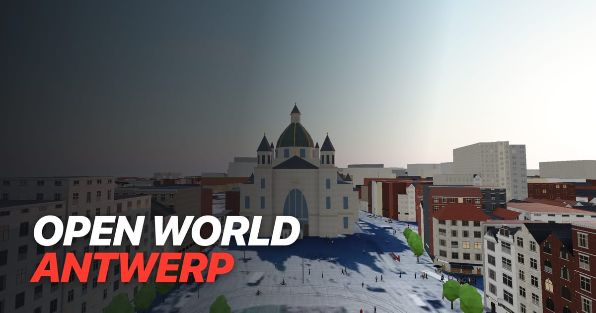

# Open World Antwerp

A driving sandbox in a 1:1 slice of central Antwerp, built from open data and playable in the browser. Written in
TypeScript with Three.js and Rapier.

**[Play it](https://antwerp.noahguerin.dev)**



## Features

- Cars, trams, buses, Velo bikes and e-scooters
- Real streets, buildings, shops and trees, with trams and buses on De Lijn's timetable
- Antwerp's real sun and live weather
- Shared multiplayer world

## Getting started

Requires Node 24 and pnpm 11.

```sh
pnpm install
pnpm dev
```

Then open http://localhost:5173. WASD to move, E to get in or out. Esc lists every control.

## Documentation

- [Architecture](docs/architecture.md)
- [Map pipeline](docs/map-pipeline.md)
- [Multiplayer](docs/multiplayer.md)
- [Development](docs/development.md)

## Credits

- Map data © [OpenStreetMap](https://www.openstreetmap.org/copyright) contributors ([ODbL](https://opendatacommons.org/licenses/odbl/))
- Building heights: Bron: Grootschalig Referentie Bestand Vlaanderen, Digitaal Vlaanderen ([3D GRB](https://www.vlaanderen.be/digitaal-vlaanderen/onze-diensten-en-platformen/basiskaart-vlaanderen-grb/3d-grb), Modellicentie Gratis Hergebruik v1.0)
- Aerial photo: Bron: Orthofotomozaïek, middenschalig, winteropnamen, kleur, meest recent, Vlaanderen, Digitaal Vlaanderen
- Trees: Groeninventaris, [Stad Antwerpen](https://portaal-stadantwerpen.opendata.arcgis.com)
- Timetables: [De Lijn](https://data.delijn.be) (GTFS)
- Weather: [Open-Meteo](https://open-meteo.com) ([CC BY 4.0](https://creativecommons.org/licenses/by/4.0/))
- People: [Microsoft Rocketbox](https://github.com/microsoft/Microsoft-Rocketbox) (MIT)
- Textures: [Poly Haven](https://polyhaven.com) (CC0)
- Logos: Wikimedia Commons, see `public/map/logos.html`
- Radio: VRT and DPG Media live streams

Not affiliated with any brand shown in the game.

## License

Code: [MIT](LICENSE). Data and assets keep their own licences, listed above.
